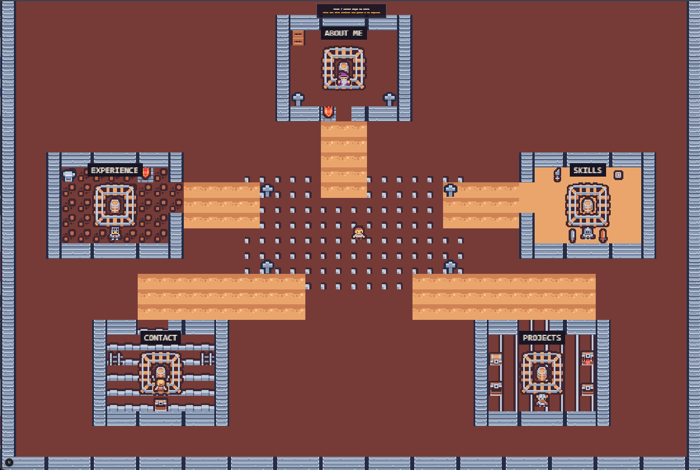
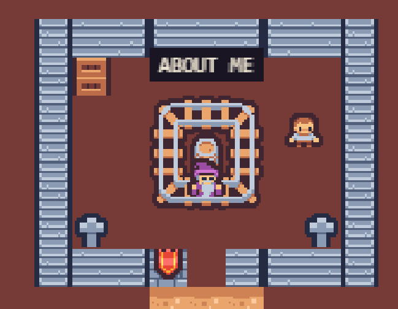
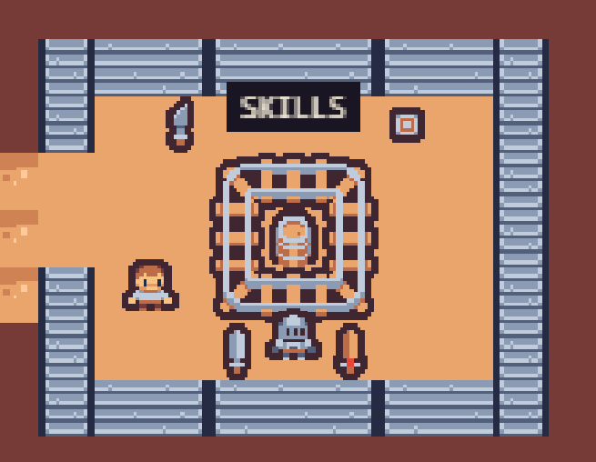
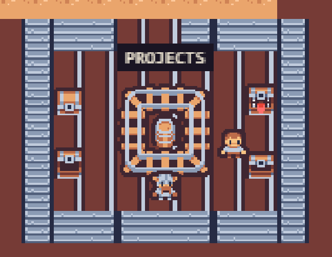
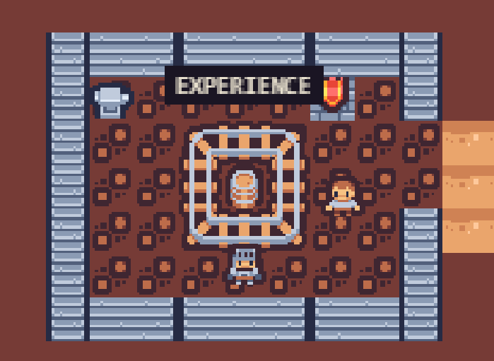
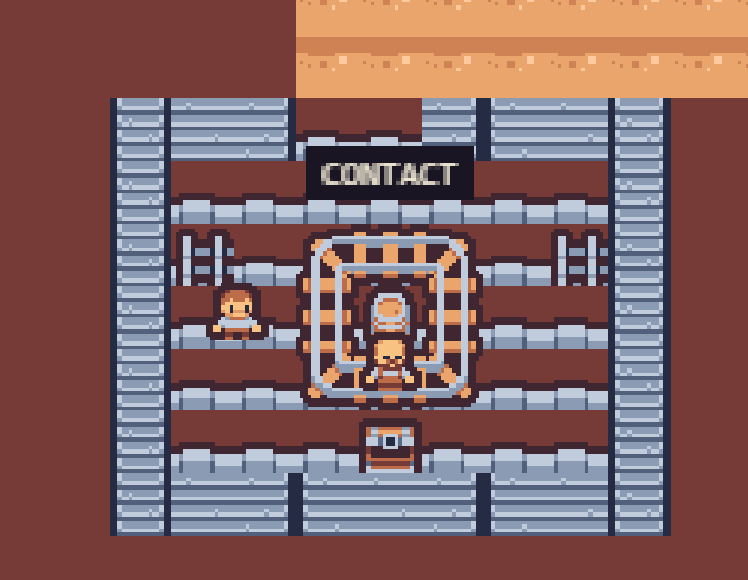
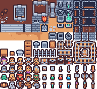

# Pixelfolio



An explorable pixel-art portfolio by **Abdullah**. Instead of scrolling
through a conventional portfolio, walk through a Tiny Dungeon world, find the
five shrines, and discover each section in context.

Built with **Next.js**, **React**, **TypeScript**, **Tailwind CSS**, and
**Phaser 3**. React renders the portfolio panels and dialogue overlays, while
Phaser powers the playable world, movement, collisions, camera, scene
transitions, and in-world interactions.

## What is inside

- A playable hub with five destinations: About Me, Skills, Projects,
  Experience, and Contact
- Dedicated Treasure Vault and Contact dungeon scenes
- NPC, shrine, chest, prop, and dialogue interactions
- Project detail cards with links to GitHub repositories
- Keyboard controls on desktop and an on-screen D-pad for touch devices
- Responsive portfolio overlays that work across desktop and mobile
- Centralized portfolio content that can be edited without changing game logic

## Screenshots

### The hub world

The central village connects every portfolio section. Walk to a shrine and
press `E` to explore it.


### About Me



### Skills



### Projects

The Projects shrine leads to the Treasure Vault, where each chest represents a
project and opens its details and repository link.



### Experience



### Contact



## Getting started

### Requirements

- Node.js 20 or newer
- npm

### Run locally

```bash
npm install
npm run dev
```

Open [http://localhost:3000](http://localhost:3000) in a browser.

### Production build

```bash
npm run build
npm run start
```

| Script | Purpose |
| --- | --- |
| `npm run dev` | Start the Next.js development server |
| `npm run build` | Create a production build |
| `npm run start` | Serve the production build |
| `npm run lint` | Run the configured Next.js lint command |

## Controls

| Action | Keyboard | Touch |
| --- | --- | --- |
| Move | `W` `A` `S` `D` or arrow keys | On-screen D-pad |
| Interact | `E` near a shrine, NPC, or object | On-screen interact button |
| Advance dialogue | `E` or click a dialogue choice | Tap the dialogue choice |
| Close a panel or dialogue | `Esc` | Close button |

The About Me, Skills, and Experience shrines open React panels. Projects and
Contact lead to dedicated dungeon scenes, where nearby characters and objects
open dialogue choices. On mobile, touch controls appear automatically.

## Customization

Most portfolio content lives in [`src/data/portfolio.ts`](src/data/portfolio.ts):

- `aboutContent`: name, role, bio, tagline, and technologies
- `skillsContent`: skill groups and icon keys
- `projectsContent`: project descriptions, technologies, and links
- `experienceContent`: roles, companies, dates, and achievements
- `contactContent`: email and social links
- Dialogue scripts and location labels

To reshape the playable world, edit [`src/game/config/mapData.ts`](src/game/config/mapData.ts)
and the scene-specific map data files. Tile indices refer to the 12 x 11 grid
of 16 x 16 tiles in [`public/assets/tiny-dungeon/tiles.png`](public/assets/tiny-dungeon/tiles.png).

## Project structure

```text
src/
├── app/                    Next.js App Router entry and global styles
├── components/
│   ├── game/               Phaser mount point and dialogue UI
│   ├── portfolio/          React portfolio panels and project details
│   └── ui/                 Loader, interaction prompt, and mobile controls
├── data/portfolio.ts       Editable portfolio and dialogue content
└── game/
    ├── main.ts             Phaser.Game configuration
    ├── scenes/             Hub and dedicated dungeon scenes
    ├── entities/           Player movement and animation
    ├── systems/            Events, proximity, camera, and transitions
    └── config/              Maps, asset keys, and dungeon data
```

## Assets and licensing

The world uses Kenney's free **Tiny Dungeon** tileset. The complete tile sheet
is available at [`public/assets/tiny-dungeon/tiles.png`](public/assets/tiny-dungeon/tiles.png),
and its **CC0** license is included in
[`public/assets/tiny-dungeon/LICENSE`](public/assets/tiny-dungeon/LICENSE).



The pack contains static single-frame characters rather than walk-cycle sprite
strips, so player movement uses a procedural squash-and-stretch bob and
horizontal flipping.
